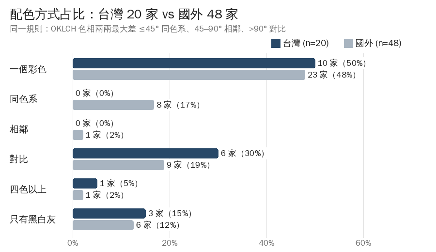
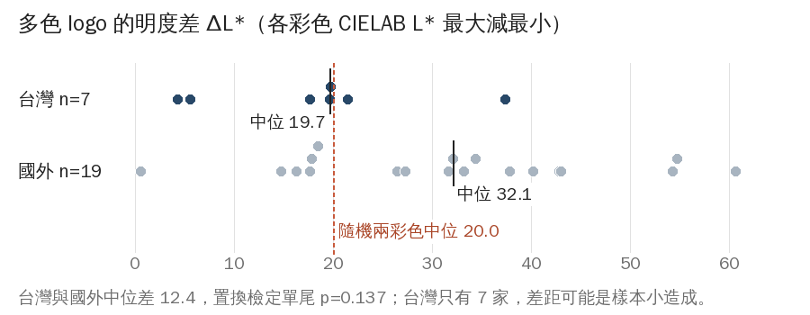
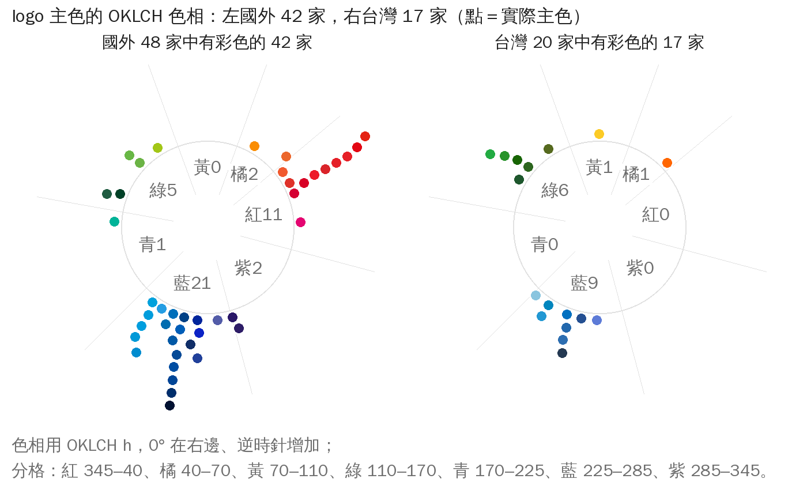
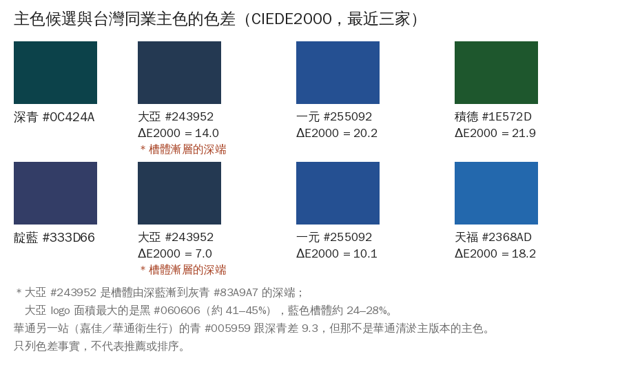
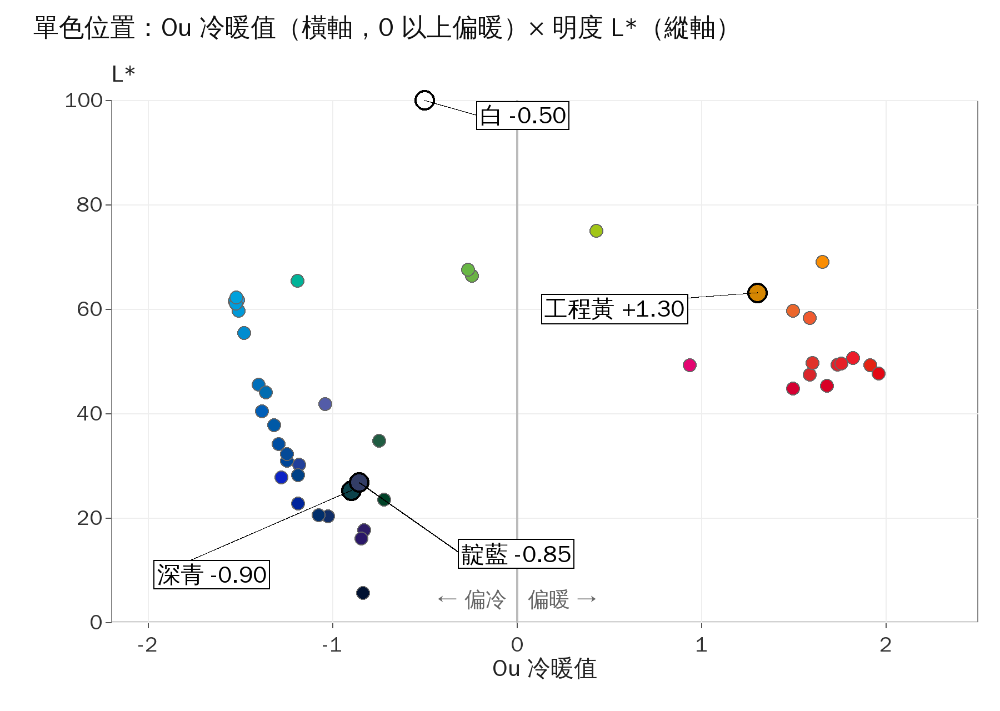
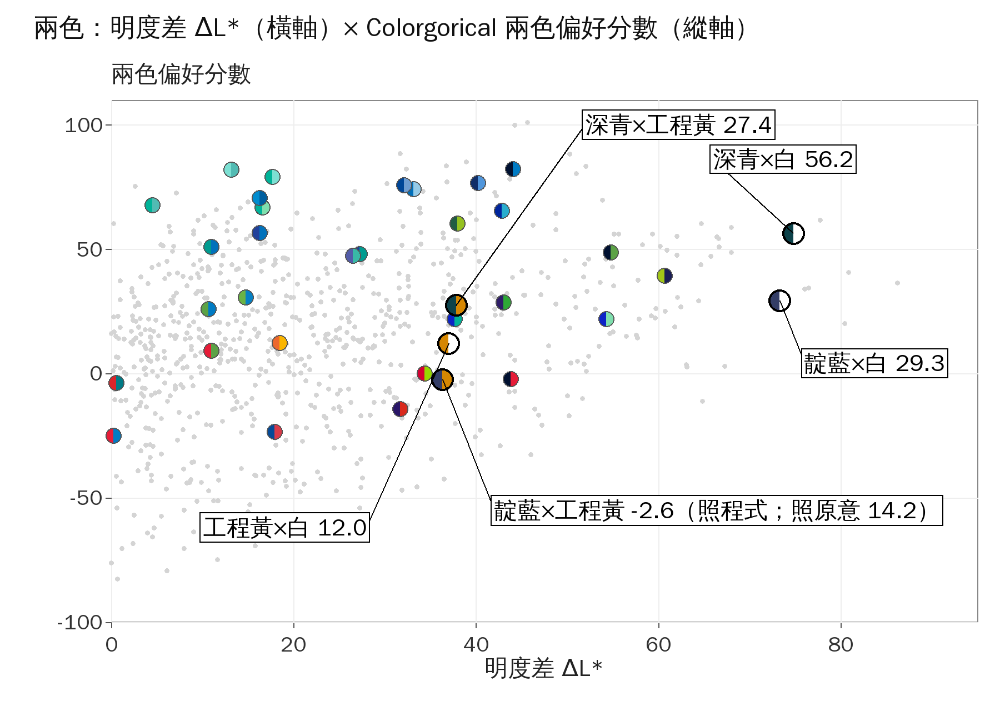
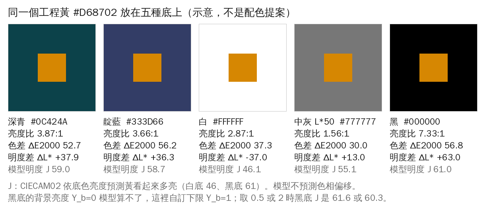
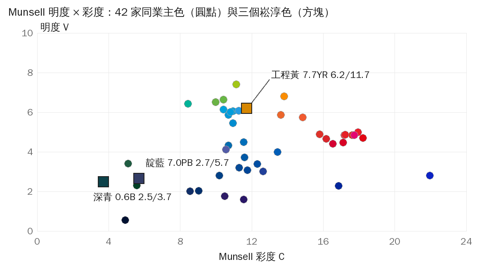
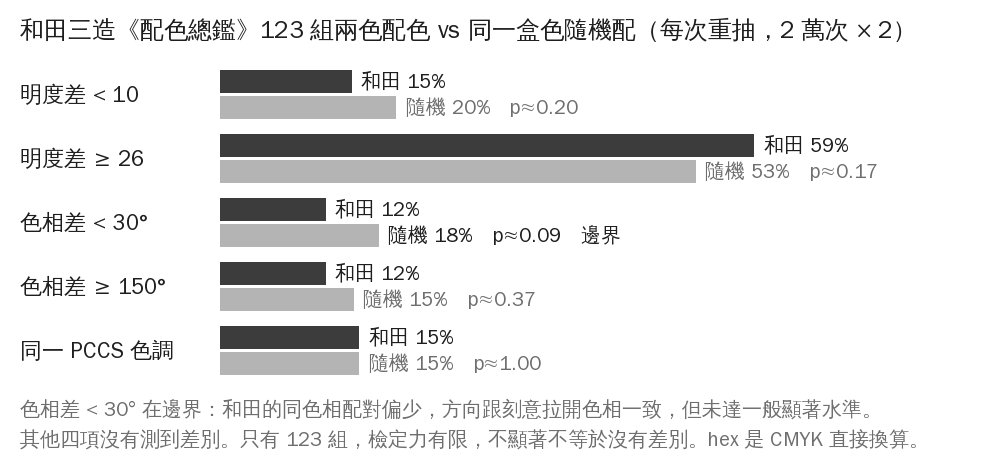
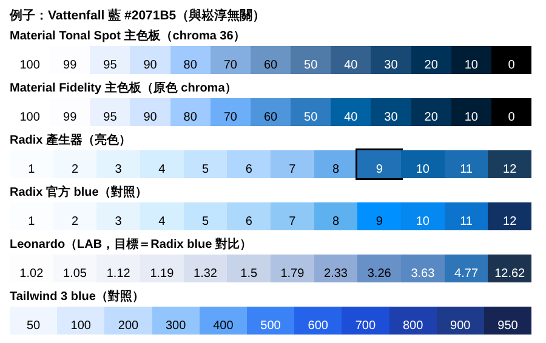

> 這是 34 頁 PDF 報告《配色與設計理念・第二輪》（10-20）的文字版，給 GPT 參考，決定權在梁特助。
> 自己畫的圖表放在 `圖/`，下面直接引用；照片、第三方 logo 與車身裁切圖只在 PDF 裡（專案資料夾與梁特助電腦），不進 repo。
> 色塊圖在文字版換成「色塊圖，見 PDF」，數據放在文末附錄。頁碼指 PDF 頁碼。

# 配色與設計理念
第二輪：國內同業、色彩研究、配色模型、色階
崧淳環保科技 CIS 學習報告 2026 年 10 月 20 日 Claude 整理，給梁特助
〔PDF 此處有圖：v_dsd.jpg（照片或第三方 logo，不進 repo）〕
　說明：香港渠務署的吸渠車。整台車漆成黃色，標誌只在車門上一小塊。照片：Negi，維基共享資源，CC BY-SA 3.0。
這是學習報告，不是配色提案。主色怎麼定，由梁特助決定；配色與設計由 GPT 主導，Claude 輔助。第一輪報告（10 月 17 日，33 頁）講過的不重講；接著第一輪往下做的，頁內標「延續第一輪」。

## 先講結論
第一輪看的是國外 48 家。這一輪補上國內 21 家同業，讀了 4 篇色彩研究全文和 3 篇摘要，把 2 個有原始程式的配色模型、3 套設計系統的色階做法改寫來跑，也拿實際顏色去量 Itten、Munsell、PCCS 這些理論。學到八件事：
1. **台灣同業跟國外一樣，一半只用一個顏色加黑白。**台灣 20 家有 10 家，國外 48 家有 23 家。
2. **台灣用兩色的，幾乎都是藍或綠配紅、橘；深淺差比國外小。**7 個多色 logo 有 6 個是對比色；兩色明度差中位 19.7，跟隨機配兩色（20.0）差不多，國外是 32.1（台灣樣本小，p＝0.14）。7 家裡華通、日技兩色幾乎一樣深，轉成黑白會糊在一起。
3. **台灣同業的主色沒有紅色。**17 家是藍 9、綠 6、橘 1、黃 1；國外 42 家有 11 家是紅。
4. **有車照的同業，4 家是黃橘槽車，跟自己 logo 的顏色無關。**宏隆、日技、派浦崴洱、一元的槽車跟工程黃差 4.3 到 14.8（照片取最常見的顏色，改取中位數差會更大）。延續第一輪：黃車像反光衣一樣，是這一行共用的顏色（推論），這輪補上台灣的實例。
5. **人喜歡一個顏色，多半是喜歡那個顏色的東西。**柏克萊的研究：顏色受不受喜愛，有 80% 的差異可以用「這個顏色的東西討不討喜」解釋（相關 0.893，不是因果）。藍讓人想到晴空、淨水；褐讓人想到糞便、腐物。
6. **兩色配，「喜歡」跟「和諧」不是同一件事。**色相相近，兩者都加分；深淺拉開對「喜歡」的作用比對「和諧」大。
7. **教科書的配色規則，拿真實顏色去量，多半說不準。**Itten 七種對比互相重疊；和諧模板任兩色都放得進；和田三造的配色跟隨機配比，看不出明確規則。
8. **設計系統把一個顏色展開成一排深淺，每一階有固定用途。**Radix 分 12 階、Material 分 13 個明度、Leonardo 照對比值去找色。

## 這輪多了什麼，更正了上輪什麼
| 主題 | 第一輪 | 第二輪 |
|---|---|---|
| 國內同業 | 17 筆主色（14 筆抄自 10-11 筆記，3 筆取自 10-13 補充報告） | 21 家 31 個版本逐張量色、分組，跟國外用同一支程式比 |
| 色彩研究 | 只讀到摘要或整理稿 | 4 篇原文附頁碼，3 篇付費牆只讀摘要 |
| 配色模型 | 色名模型（中文 uwdata、英文 XKCD） | 冷暖公式、兩色偏好分數，用原作者測試值驗過；色名沒有新結論 |
| 配色理論 | 色相環、60-30-10 簡述 | Itten、Albers、Munsell、PCCS、NCS、和田三造、Matsuda 逐一實算 |
| 色階 | 無 | Radix、Material、Leonardo 改寫成程式，用原庫測試值或官方色系驗過 |
| 資源與 skill | 色彩知識庫一套 | 23 項，讀原始碼，量它們自己的說法 |

### 更正第一輪
1. **國外 48 家的分組改成 23／8／1／9／1／6**（一個彩色／同色系／相鄰／對比／四色以上／只有黑白灰）。上輪寫 23／7／3／8／1／6。差在兩家：Sydney Water 兩色色相差 44.2°，剛好算同色系；Uisce Éireann 三色最大差 105°，算對比。「一個顏色加黑白最多」不變。
2. **上輪的台灣 17 筆主色有 3 筆錯。**邦盛的紅是標語「專人為您服務」，不是公司名；綠邑 #254529、銘源 #082066 是網站顏色，不是 logo 色。
3. **Bae 等 2015 上輪寫「只讀到摘要」，這輪讀了原文**：是 3 到 10 人的知覺實驗，結論不變，見第 14 頁。

延續第一輪、沒有新結論的：英文色名（第 17 頁，跟第一輪是同一份資料）、工程黃配深青與靛藍的亮度比、黃車是全行業共用色、報告用白底。這些頁內都標了。
> 怎麼看每條的可信度：**原文**＝打開原始檔讀到；**實算**＝我跑程式算的；**摘要**＝只讀到摘要或別人轉述；**目視**＝看圖判斷；**推論**＝我的推測。台灣同業、配色理論、配色模型、色階四部分的數字，都另外交給查核者獨立重算或回原始檔核對，錯的已改；論文引句附頁碼。美感部分（第六部分）是跟美感串的筆記核對，論文本身多半只讀到摘要。

# 一、國內同業

## 21 家台灣同業的 logo
來源有兩份：你電腦上的 14 家資料夾（銘源沒有 logo 圖，有圖的 13 家），和 10 月 13 日兩份台灣同業報告（登記 25 家，14 家查不到 logo）。兩邊重疊 3 家，共 21 家、31 個版本。
〔PDF 此處有圖：fig_tw_logo_grid_v3.png（照片或第三方 logo，不進 repo）〕
　說明：21 家的主版本，白底等比縮放。積德是智財局 2001 年的商標圖樣；九升、派浦崴洱、龍祥取自第三方網頁；邦盛、康立取網站橫幅上的字；順捷是墨色商標，不計色。圖為各公司所有，只供內部學習。

## 每家用了哪些顏色、各佔多少
一條就是一個 logo，長度＝100%，每段寬度＝那個顏色佔 logo 非白部分的比例（白色不算）。右邊是配色方式。量法：只有幾個純色的圖逐點數，其他圖先去掉邊緣的雜色。（實算）
〔色塊圖，見 PDF；數據見文末附錄〕
多數台灣 logo 整個都是彩色（彩色佔非白部分的中位數 99.7%）；低於三成的只有源昌（橘只佔 4.5%，主體是深灰）。

## 配色方式：跟國外幾乎一樣

　說明：台灣 20 家（扣掉墨色商標的順捷）對國外 48 家，同一支分組程式：OKLCH 色相差 45° 以內算同色系、45–90° 相鄰、90° 以上對比。（實算）
- **一個彩色加黑白：**台灣 10／20（50%），國外 23／48（48%）。統計上沒有差別。
- **不一樣的是用兩色以上的：**台灣 7 家有 6 家是對比色、沒有同色系；國外 19 家是對比 9、同色系 8、相鄰 1、四色 1。台灣樣本小，差別還不能確定（p＝0.18）。
- **只看各家官網上的 logo 檔**（14 家）：7／0／0／5／1／1，方向一樣。

## 用兩色的：對比色，深淺差比國外小
上排是 logo 裡的彩色，下排是同一個顏色轉成黑白。7 家裡華通、日技轉黑白幾乎分不開；其他 5 家明度差 17.7 到 37.4。第一輪的國外兩色 logo 有 68% 明度差在 26 以上，台灣 7 家只有天福到 26。
〔色塊圖，見 PDF；數據見文末附錄〕
ΔL*＝最亮減最暗的彩色明度差；百分比＝各彩色佔非白部分的比例。天福有四個彩色。

　說明：多色 logo 的明度差：台灣 7 家中位 19.7，國外 19 家中位 32.1；紅虛線是隨機配兩個彩色的中位 20.0。國外比台灣多 12.4，但台灣只有 7 家，統計上還不能確定（p＝0.14）。（實算）
- 6 家兩色 logo 裡，5 家是藍或綠配紅、橘。第二色真的只是一小點（不到一成）的只有大亞、日技、升野；華通的紅褐佔 28%、積德的紅 21–27%、宏隆的橘約一半。

## 主色：藍綠為主，沒有紅

　說明：每家主色在色相環上的位置：左國外 42 家、右台灣 17 家（有彩色主色的才列）。（實算）
| 主色 | 台灣 17 家 | 國外 42 家 |
|---|---|---|
| 藍 | 9 | 21 |
| 綠 | 6 | 5 |
| 紅 | 0 | 11 |
| 橘、黃 | 2（源昌、升野） | 2 |
| 青、紫 | 0 | 3 |

「台灣沒有紅主色」單獨看算顯著（p＝0.024），但這輪做了約 8 個比較、沒有做多重比較校正，只能當方向看。台灣主色明度中位 0.536、國外 0.564；彩度 0.129 對 0.149，台灣略暗、略灰（只是中位數差，沒做檢定）。宏隆綠橘各佔約一半，主色算綠或橘，綠會是 6 或 5。

## 漸層、毛筆字、畫什麼
| 項目 | 台灣 | 對照 |
|---|---|---|
| 用漸層 | 6／20（大亞、久大、宏隆、康立、積德、龍祥；康立、龍祥的漸層在網站橫幅底色上，不在 logo 本身）；只算官網 logo 檔 3／14 | 國外上輪文字記到至少 4／48（只是下限） |
| 字（目視） | 黑體 11、毛筆 4（源昌、宏隆、康立、一元）、只有圖沒有字 4、明體或楷體 2（逸居公司名是明體） | 升野的粗筆帶毛筆感，算黑體有爭議；改算毛筆就是黑體 10、毛筆 5 |
| 圖形（目視，可多項） | 只有字 6、水滴水波 5、箭頭循環 4、管 3、字母 3、抽象 2 | 10-11 筆記的「水滴、管件、葉片」大致成立 |
| 畫出本業的 | 只有升野的圖形畫了管內攝影車 | 其他家看圖猜不出是清管或攝影 |

> 讀法（推論）：台灣小同業比較常用漸層、毛筆字，國外大公司多是平面單色 logo。第一輪量到漸層和細筆在縮小、印刷、刺繡時最先壞掉；台灣同業這兩種做法用得多，要知道它的代價。
漸層判斷靠目視加量測明度跨度（例：久大藍 0.25、龍祥綠 0.33）。九升小圖看不清。字形分類沒有字型檔可對。

## 車身：4 家同業的槽車是黃橘色
〔PDF 此處有圖：tw_honglong.jpg（照片或第三方 logo，不進 repo）〕
　說明：宏隆：黃色槽體。logo 主色是綠。照片：你電腦崧淳同業logo資料夾。
〔PDF 此處有圖：tw_tianfu.jpg（照片或第三方 logo，不進 repo）〕
　說明：天福：白色槽車。logo 主色是藍。照片：你電腦崧淳同業logo資料夾。
〔PDF 此處有圖：tw_yiyuan.jpg（照片或第三方 logo，不進 repo）〕
　說明：一元：淡黃車身。logo 主色是藍。照片：你電腦崧淳同業logo資料夾。
〔PDF 此處有圖：tw_huatong.jpg（照片或第三方 logo，不進 repo）〕
　說明：華通：綠色槽體，跟 logo 同色相。照片：10-13 補充報告 p5 的網站橫幅。
〔PDF 此處有圖：fig_vehicle_colours_v3.png（照片或第三方 logo，不進 repo）〕
　說明：從照片裁切量的車身色，對照各家 logo 色與崧淳工程黃 #D68702。日技的車照解析度低，只放裁切小圖量色。（實算）
- 宏隆、日技、派浦崴洱、一元的槽車是黃橘，跟工程黃差 4.3、6.7、13.9、14.8，跟各自 logo 色無關。這是照片裡最常見的顏色；查核改取中位數，宏隆是 15.5、日技 7.6，數字會隨量法變。
- 車身跟 logo 同色相的只看到華通（綠槽，但比 logo 綠亮很多，色差 33.5）。天福是白槽車、大亞與逸居是藍車頭（可能是原廠車色）。

照片著作權屬各公司，只供內部學習。

## 深青、靛藍離台灣同業多遠
只列事實，不做取捨。色差用 CIEDE2000，小於 10 算「看得出很像」，第一輪用的是同一條線。

　說明：兩個主色候選跟最近三家台灣主色的色差，大亞的取色說明在圖內。（實算）
|  | 深青 #0C424A | 靛藍 #333D66 |
|---|---|---|
| 最近的台灣主色 | 大亞 14.0、一元 20.2、積德 21.9 | 大亞 7.0、一元 10.1、天福 18.2 |
| 10 以內的台灣主色 | 0 家 | 1 家（大亞） |
| 算進次色與其他版本 | 華通衛生行的青 #005959（9.3） | — |
| 第一輪：國外最近 | Ventia 16.7 | Insituform 6.7（國外 10 以內 4 家；第一輪另列台灣大亞 7.4，這輪改用槽體深端 #243952，是 7.0） |

# 二、色彩研究：人怎麼感受顏色

## 喜歡一個顏色，是喜歡那個顏色的東西
Palmer & Schloss 2010，美國國家科學院院刊（PNAS）。原文已讀。
〔色塊圖，見 PDF；數據見文末附錄〕
色塊是我畫的示意，不是論文的色票。
- 48 位受試者看 32 個顏色打分數。另一批人寫出每個顏色會想到的東西，再評那些東西討不討喜。
- 「這個顏色的東西平均討不討喜」跟「這個顏色受不受喜愛」相關 0.893，**單一個變項就解釋 80%**（原文 p.8879）。比錐細胞模型（37%）、色貌模型（60%）、Ou 的色彩情感模型（55%）都高。
- 它抓到曲線的形狀：藍最高、黃綠最低、鮮的比濁的好、暗黃附近最低。失準兩處：深橘（偏褐）實際更不受喜愛，作者推測是巧克力、咖啡拉高了預測；深紅實際更受喜愛，作者推測是血拉低了預測（p.8879）。
- 這篇被 Google 的 Material 配色程式引用：它把「暗黃綠」寫成要自動提亮的不喜歡色（程式註解，原文已讀）。

> 對清淤業的意思（推論）：這行每天碰的正是糞便、汙泥、腐物。顏色會讓人想到什麼東西，比色票本身的好壞更重要。工程黃在 Material 的不喜歡區外（色相差 20.7°），但這是螢幕上的小色塊實驗，不是車身。

## 兩色配：「喜歡」跟「和諧」不一樣
Schloss & Palmer 2011，Attention, Perception & Psychophysics。原文已讀。
- 同一批 48 人，32 個顏色組成 992 組「小方塊放在大方塊上」，分別評喜不喜歡、和不和諧（p.554）。
- **色相相近：**喜歡和和諧都加分（p.551）。
- **深淺拉開：**對「喜歡」的作用比對「和諧」大（p.569）。把和諧與兩色各自的喜好放進模型後，明度差還能多解釋 4.5% 的喜歡（p.560）。
- **和諧靠什麼：**色相近、偏冷、不太鮮、冷暖程度接近，共解釋 67.3%（p.560）。
- 平均來看，喜歡跟和諧相關 0.79；但每個人差很多，從 −0.03 到 0.75（p.559、561）。
- **前景色那一題方向相反：**色相差越大，前景色越受喜愛，但限於兩色明度相近時（p.567）。淺色放在深底、深色放在淺底，比較受喜愛（p.566）。

### Ou & Luo 2006 的和諧模型（摘要）
由彩度差、明度和、明度差、色相四項組成；色相越近越和諧，跟 Schloss 的結果一致（兩份來源）。「明度差小於約 15 會降低和諧」「藍最容易和諧、紅最不容易」只見於一份專利，佐證不足。公式拿不到原文，這輪不用。
> 跟第一輪「明度拉開」連起來（推論）：國外同業多色 logo 拉開深淺，符合「讓人更喜歡」；但和諧另外靠色相相近。兩件事要分開談。

## 顏色的情緒：30 國很像
Jonauskaite 等 2020，Psychological Science。作者接受稿已讀。
- 30 國、4,598 人、22 種母語，把 20 種情緒配給 12 個顏色名稱（p.6）。**給的是顏色名稱，不是色塊**（p.13）。
- 各國跟全球平均的相似度 0.88（埃及 0.684 到西班牙 0.941）；國與國之間平均 0.78（p.21）。
- 每一國都一樣：紅與黑的情緒聯想最多，**褐最少**（p.23）。
- 最明顯的聯想：黃—喜悅；橙—喜悅、好玩；白—安心；灰—悲傷、失望。藍沒有進入最明顯的清單（p.19–20）。

### 顏色記憶會往「名字的中心」偏
Bae 等 2015，Journal of Experimental Psychology: General。原文已讀。
人記住的顏色，會被拉離兩個色名的交界、往最典型的那個顏色靠；直接看著配也有同樣偏差（摘要 p.2）。受試者只有 3 到 10 人，是知覺實驗。
> 延續第一輪（推論）：深青剛好落在「綠」和「藍」的交界，第一輪中文模型兩邊各 38%。這篇的結果暗示，人回想時可能把它記成偏綠或偏藍。這輪讀了原文才知道：實驗的色票都是中明度（L* 70），深青 L* 約 25，外推更遠；沒有實驗測過深青。

### 只讀到摘要、不拿來下結論的
- Ou 等 2004：單色有三個情感因子，活動、重量、冷暖（三份來源一致）。
- Labrecque & Milne 2012「紅＝興奮、藍＝能幹」：只見於標題和非學術網站，佐證不足。
- 網路流傳的「藍色讓 74% 的人覺得可信」查不到出處，不要用。

# 三、能算的配色模型

## 冷暖公式：深青、靛藍分不出來
Ou 的冷暖公式。原論文付費牆；Google Material Color Utilities 的程式裡有完整公式和測試值，註明出自 Ou、Woodcock、Wright（原文已讀，程式沒寫年份），我改寫後全部對上。

　說明：小圓：48 家國外同業裡有彩色的 42 家主色；黑框大圓：深青、靛藍、工程黃、白。公式取自 Google Material Color Utilities 程式（註明 Ou、Woodcock、Wright，程式沒寫年份）；Ou 原論文未取得，受試者與實驗條件沒讀到。（實算）
- 國外同業主色 28 冷、14 暖，中位 −0.93。深青 −0.90、靛藍 −0.85，在 42 家的中位附近；但 28 家偏冷的同業裡有 21 家比它們更冷，所以屬冷群裡較不冷的一側。工程黃 +1.30。
- 同業在圖上分成「藍綠」和「紅橘」兩群，中間幾乎沒有人（目視）。
- 這個公式只看色相和鮮度，深青和靛藍色相差 70°，冷暖分數卻幾乎一樣。

## 兩色偏好分數：同業比隨機高
Colorgorical（Gramazio、Laidlaw、Schloss 2017）把第 13 頁 Schloss & Palmer 2011 的實驗寫成公式：明度差加分、色相差扣分、兩色越冷越加分。原始碼已讀，作者的色差上下限重現了。

　說明：灰點：隨機 sRGB 兩色 800 組（固定種子）；小雙色圓：國外同業 logo 實際兩色 30 對；黑框大雙色圓：本報告比較的配對。Colorgorical 程式算色相差沒有繞回 360°，跨過紅色的配對分數會偏低；靛藍×工程黃照原意改算是 14.2，會落在工程黃×白旁邊。（實算）
| 兩色偏好分數中位 | 總分 | 明度項 | 冷度項 |
|---|---|---|---|
| 同業 logo 實際配對（30 對） | 47.6 | 20.7 | 52.2 |
| 同業顏色打亂重配（2,115 對） | 26.4 | 11.3 | 42.5 |
| 隨機兩色（5,000 對） | 15.7 | 15.0 | 26.5 |

明度項、冷度項的隨機組是 4,981 對（扣掉 19 對走無彩色內插的）。跟打亂重配比，冷度項和明度項各多約 9.5，兩者差不多。這個差距也不穩：從打亂的配對裡隨機抽 30 對，約 5% 的機會中位數也到 47.6；只在 19 家多色公司之間打亂，中位數是 40.4。這個分數只是柏克萊 48 人看螢幕上小方塊配大方塊的平均喜好，**不等於好看**，也不知道放大到車身、招牌還準不準。

## 延續第一輪：叫不叫得出名字
這頁沒有新結論，放進來是說明為什麼。
第一輪已用英文（XKCD，經 Heer & Stone 的 c3）和中文（uwdata）色名資料量過。這輪 Colorgorical 內建的色名表是同一份 XKCD 資料，它的「名字分散度」就是 1 減第一輪的顯著度，前幾名的名字也一樣：
〔色塊圖，見 PDF；數據見文末附錄〕
- **這輪新的只有兩點：**放進 42 家國外同業主色比，深青的分散度比 42 家都高（同業中位 0.483），靛藍第 95 百分位；同業 logo 實際的兩色，色名差中位 0.85，比隨機（0.985）低，同業常把同一色名家族的深淺放在一起。（實算）
- 深青×工程黃、靛藍×工程黃的色名差都是 1.00，英文叫法完全不重疊。

> 結論跟第一輪一樣：深青不好叫名，靛藍好叫但歸在大家都在用的「藍」。哪一個比較好，要看要的是「好記」還是「不撞色」，由梁特助判斷。

## 模型會錯在哪裡
1. **程式跟論文不一致。**Colorgorical 算色相差沒有繞回 360°，跨過紅色的配對會被多扣分。隨機兩色有 27% 受影響，國外同業 30 對裡 5 對受影響。靛藍×工程黃照程式算 −2.6，照原意算 14.2。（原文＋實算）
2. **正規化上下限重現不了。**色差的上下限用 8,325 色全配對重現了，兩色偏好的上下限試了 5 種算法都對不上，所以只比排名，不比絕對分數。
3. **兩套規則對同一個顏色意見不同。**Colorgorical 作者手訂「黃褐懲罰區」（Lab 色相 70–115、明度 75 以下，分數乘 0.8），工程黃在裡面；國外同業 66 個彩色沒有一個在這區，只有 Mini-Cam 的亮黃落在旁邊明度 75 以上那區（乘 0.85）。Material 的不喜歡區（暗黃綠）則不包含工程黃，差 20.7°。
4. **受試者與情境很窄。**Colorgorical 的偏好資料是柏克萊 48 人看螢幕色塊、灰背景；Ou 的冷暖也是實驗室色塊。沒有台灣人、沒有車身、沒有日光。

> 學到的（推論）：模型分數是「一群人在實驗室的平均反應」，能幫忙找出明顯的問題（例如兩色太近、轉黑白糊掉），不能用來決定哪個顏色比較好看。程式裡的錯也要自己驗過才知道。
Ou 的另外兩個因子（輕重、主動被動）和 Ou & Luo 2006 的和諧公式沒拿到原文，沒有算。Palettailor 只算類別分辨度、色名差，和配色內兩兩之間與每色對背景的最小色差，另有色名篩選；沒有偏好或和諧分數。

# 四、配色理論拿來量

## Itten 七種對比：用同業的真實顏色看
上排是原色，下排轉成黑白。七種裡五種在單一同業 logo 裡找得到；面積對比沒有資料，同時對比只能拼示意。（實算）
〔色塊圖，見 PDF；數據見文末附錄〕
- **補色、冷暖這兩組轉黑白就糊掉**：Kier 的紅配藍綠（第一輪已提）、Watercare 的紅配藍，兩色幾乎一樣亮。
- **學界的批評**（Hirschler 演講逐字稿，原文已讀）：色相、明暗其實是顏色的屬性，不是對比；冷暖是相對的；面積公式沒算鮮度；一對顏色就能同時展現七種，所以七種互相重疊。

## 同一個黃，放在不同底上
Albers《色彩互動》的核心：顏色看起來怎樣，看它旁邊是什麼。這是示意，不是配色提案。

　說明：同一個工程黃 #D68702 放在深青、靛藍、白、中灰、黑上。下方是亮度比、色差、明度差，和色貌模型 CIECAM02 預測「看起來多亮」（J）。黑底的背景亮度用自訂下限 1。（實算）
| 底色 | 深青 | 靛藍 | 白 | 中灰 | 黑 |
|---|---|---|---|---|---|
| 亮度比（深青、靛藍第一輪已算） | 3.87 | 3.66 | 2.87 | 1.56 | 7.33 |
| 看起來多亮 J | 59.0 | 58.7 | 46.1 | 55.1 | 61.0 |

- 同一個黃，在黑底上看起來比在白底上亮很多（J 61 對 46）。
- 深青底和靛藍底，模型算「看起來多亮」只差 0.3；亮度比 3.87 對 3.66、色差 52.7 對 56.2。
- 色相會往底色的補色偏（深青底會讓黃偏紅橘、靛藍底偏黃），但這個模型不算色相偏移，偏多少算不出來（推論：只用底色色相加 180° 推方向）。

## 三個顏色在 Munsell、PCCS 的位置

　說明：Munsell 明度（縱）×彩度（橫）：42 家國外同業主色（圓點）與崧淳三色（方塊）。換算先用 colour-science 的測試表驗過，色相誤差中位 0.03 步。（實算）
|  | 深青 | 靛藍 | 工程黃 | 國外同業主色 |
|---|---|---|---|---|
| Munsell | 0.6B 2.5/3.7 | 7.0PB 2.7/5.7 | 7.7YR 6.2/11.7 | 彩度最低 4.9 |
| PCCS 色調 | dk 暗 | dk 暗（靠近 d） | s 強 | v 鮮 21、b 8、dk 只有 2 |
| 相對彩度 | 0.91 | 0.30 | 1.00 | 中位 0.99 |
| ISCC-NBS 名稱 | 暗綠藍 | 中等紫藍 | 深橘黃 |  |

- **兩種量法結論相反。**Munsell 彩度看絕對值，深青 3.7 比 42 家同業主色都低。相對彩度看「同深淺、同色相，螢幕上最多能多鮮」，深青 0.91 已接近上限，靛藍 0.30 離上限最遠，比所有同業主色都低。
- 同業主色一半是 PCCS 的 v（鮮）；兩個候選都是 dk（暗），同業只有 2 家。

## 教科書規則量起來

　說明：和田三造《配色總鑑》123 組兩色配色，對照同一盒顏色隨機配（每次重抽，2 萬次×2）。（實算）
- **和田三造的兩色配色：**明度差、同色調比例跟隨機配沒有測到差別；色相相近（30° 內）的比例 11.7% 對 17.7%，在顯著的邊界（p 約 0.09），方向跟刻意避開同色相一致，但沒達到顯著。123 組太少，只能說沒測到明顯差別。
- **Matsuda 和諧模板**（經 Cohen-Or 2006 的程式）：19 家多色 logo 有 18 家放得進；但隨機兩色 100% 放得進，對兩色 logo 沒有篩選力。
- **「泥濁色」規則**（pro-color-harmonies）：國外同業 66 個彩色有 21 個落在它說的泥濁區，崧淳三色都不在。規則把大量真實品牌色都判成不好。
- **NCS**：以白、黑、紅、黃、綠、藍六個基本色描述，沒有明度軸。「最暖是橘、最冷是藍綠」是 Briggs 的推測，不是 NCS 的規定。

> 學到的（推論）：規則多半是「事後解釋好作品」，拿來挑顏色篩不出東西。真正量得出差別的，還是第一輪那幾件事：幾個顏色、深淺拉多開、叫不叫得出名字。

## 面積比例：公式彼此差 2 倍
叔本華給每個顏色一個「亮度權重」（黃 3/4、橘 2/3、紅 1/2、綠 1/2、藍 1/3、紫 1/4；Itten 說是沿用歌德）。Itten 照這個說亮的顏色面積要小、暗的要大，例如黃比紫 1:3。（Hirschler 演講逐字稿，原文已讀）
- 拿 Munsell 1943 年資料裡各色相最鮮那一點的明度去對：黃、橘、紅、藍對得上；紫、綠的最鮮點有兩個明度並列，取法不同，黃比紫是 1:3.0 或 1:2.25。接不接近這組權重，看怎麼取。這些是理論極限點，不是實體色票。（實算）
- 兩條「平衡面積」公式套在工程黃上：配深青，「面積跟明度 L* 成反比」說黃佔 28.5%，Munsell 式說 11.3%，差 2.5 倍；配靛藍是 29.8% 對 17.2%，差 1.7 倍。（實算，示意）
- 沒有一條公式有實驗證明「面積平衡就好看」。

兩條公式算出的黃色面積（示意，不是建議比例）
〔色塊圖，見 PDF；數據見文末附錄〕
> 跟第一輪接起來：第一輪講 60-30-10 和 Veolia「同畫面最多兩色、logo 永遠紅」。真實手冊是規定「哪裡用、用多大」，不是算一個比例。面積公式可以當起點，不是答案。

# 五、一個顏色怎麼展開成一套

## 三種做法
用跟崧淳無關的 Vattenfall 藍 #2071B5 示範。三套的原始碼都改寫成程式：Material、Leonardo 用原庫測試值核對，結果相同；Radix 產生器沒有測試值，拿官方第 9 階重產 10 個色系來驗，色差 0.9 到 9.7。（原文＋實算）

　說明：同一個藍用不同方法展開：Material 兩種變體、Radix 產生器與官方藍、Leonardo（照對比值）、Tailwind 藍。框線是原色的位置，只有 Radix 產生器那一列含原色。（實算）
- **Material**：明度就是 tone，0 黑、100 白。預設變體會把主色鮮度固定在 36，不管原色多鮮；要保留原色鮮度得改用另一個變體。
- **Radix**：每一階有固定工作（下一頁）。品牌色放在第 9 階。
- **Leonardo**（Adobe）：先寫「這一階對白底要多少對比」，再沿著白—品牌色—黑那條線找到剛好的顏色。

## Radix 每一階做什麼
|  | 階 | 用途（原文） | 色碼 | 對白底 |
|---|---|---|---|---|
|  | 1 | 頁面底色 | #fafdff | 1.02 |
|  | 2 | 次要底色 | #f2f9ff | 1.06 |
|  | 3 | 元件底色（平常） | #e4f4ff | 1.12 |
|  | 4 | 元件底色（滑過） | #d4edff | 1.21 |
|  | 5 | 元件底色（按下、選取） | #c3e3ff | 1.33 |
|  | 6 | 不可互動的細框線 | #aed6fe | 1.52 |
|  | 7 | 可互動元件框線 | #94c5f6 | 1.81 |
|  | 8 | 較強框線、焦點環 | #6aaded | 2.38 |
|  | 9 | 實色底（最純的一階，品牌色本身） | #2071b5 | 5.13 |
|  | 10 | 實色底滑過 | #0963a6 | 6.27 |
|  | 11 | 低對比文字 | #1c6eb2 | 5.35 |
|  | 12 | 高對比文字 | #1a3d5d | 11.23 |

- Material 的角色也固定取某個 tone：淺色模式主按鈕 40、按鈕上的字 100、淺底容器 90、內文 10；深色模式主按鈕改 80。（原文）
- **驗算原文說法：**Radix 文件說第 11、12 階當字夠清楚（APCA 60、90 以上），31 個官方色系都成立。Material 文件說「tone 差 50 保證對比 4.5」，tone 50 對 100 實際只有 4.48。Radix 說「第 9 階最鮮」，23 個彩色色系只有 10 個成立。
- Radix 產生器遇到偏深的品牌色會出問題：Vattenfall 藍（明度 46）展開後，第 11 階反而比第 10 階淺。

## 三個顏色放進色階裡
只列事實。HCT 是 Material 用的色彩空間：色相、鮮度、明度。
|  | 深青 | 靛藍 | 工程黃 |
|---|---|---|---|
| HCT | 211／25／25 | 276／30／27 | 69／54／63 |
| 鮮度用到上限的幾成 | 93% | 49% | 99.7% |
| Radix 最近一階 | cyan 12（3.5） | indigo 12（5.3） | amber 8（8.1） |
| 那一階的工作 | 高對比文字 | 高對比文字 | 較強框線、焦點環 |
| 左：原色 右：那一階 |  |  |  |

- 國外同業 66 個 logo 色，最近的 Radix 階全落在第 7–12 階，中位色差 4.96；隨機 2,000 色中位 6.3。
- 深青、靛藍都比 Radix 的「實色」第 9 階深很多，最接近的是給字用的第 12 階。拿 Radix 產生器展開，它照樣把原色放在第 9 階，結果第 9 階比第 10、11 階還深（深青明度 25 對 33、47；靛藍 27 對 34、45），深淺順序倒過來。查核者另跑深藍 #1F4E79，第 11 階也比第 9 階淺。（實算）
- 工程黃已經在螢幕能顯示的最鮮邊上（99.7%），沒有更鮮的空間；深青也接近上限（93%）；靛藍用到上限的 49%。

> 學到的（推論）：主色不是一個色號就完了。真正上線時要有一整排深淺：淺底、框線、實色、文字。深的主色適合當字和實色，淺底要另外展開；這一步通常交給設計系統的方法，不靠手調。

# 六、美感串交來的：造形、字體、版面

## 標誌造形
美感串第二輪整理。每條都跟美感串筆記核對過，論文本身多半只讀到摘要。
1. **看得出賣什麼的標誌，對陌生品牌有利**，熟了好處變小；行業讓人聯想負面時反而扣分（Luffarelli 等 2019，摘要）。描述可以交給字標，不一定畫圖。
2. **陌生品牌的圖形要跟名字一起出現**，圖加名字比只有一樣好看（Bresciani & Del Ponte 2017，摘要）。同一篇：陌生標誌裡黑色比彩色吸引人。
3. **外框：**購買風險高時讀成「保護」，低時讀成「拘束」（Fajardo 等 2016，摘要）。日、星、韓、港水務標誌都沒有外框。
4. **有結構（對稱、規律、幾何）對講實用的品牌較有利**，講享樂的相反（Affonso & Janiszewski 2023，摘要）。亞洲水務與經典企業 22 個標誌，多數只用一種手法；台電、中油的多元素徽章是例外，也是線最細的（寬的 1/290、1/140）。
5. **圓讓人覺得舒適、尖角覺得耐用**，但旁邊文字講反就消失，也查不到重複驗證（Jiang 等 2016，摘要）。

> 跟配色連起來（推論）：第 1 點的「行業負面聯想」跟第二部分 Palmer & Schloss 的褐色、腐物方向相近，都提醒要留意讓人聯想到汙物。清淤業算不算負面行業，研究沒測。

## 中文字標與標準字
1. **中文品牌名主要靠字形被記住**（Pan & Schmitt 1996 等，摘要）。台灣受測者認為楷體最能代表台灣（黃耀明 2023，搜尋片段）；但 22 個亞洲標誌裡看得出中文字體的 7 個，沒有一個用楷體（6 個黑體或特製、1 個書法）。台灣同業 21 家：黑體 11、毛筆 4。
2. **中文標準字要逐字調：**大小、重心、中宮、粗細靠眼睛；英文另選，不用中文字型內建的（justfont、許瀚文、森澤，全文）；縮到 0.4 公分還要認得（陳敦化）。
3. **反 AI 清單互相矛盾：**Anthropic 的 frontend-design 把米色底配襯線列為 AI 樣子，另一個開源 skill 卻把幾乎同色的暖白底配襯線當解方。延續第一輪用白底；這輪新看到兩份清單互相矛盾，所以不要把暖白當安全牌。（原文）

### 這輪沒做完
- 你電腦上的 4 篇日文字體論文、Jiang 2016 全文細節。
- 楷體、黑體縮小比較。

這兩項要你在美感串回一句才會接著做。

## 車身上的顏色與字
〔PDF 此處有圖：v_tokyo.jpg（照片或第三方 logo，不進 repo）〕
　說明：東京都水道局：白車加一條藍帶，白字只在色帶裡。Ypy31，CC0。
〔PDF 此處有圖：v_cpc.jpg（照片或第三方 logo，不進 repo）〕
　說明：台灣中油：白、紅、藍條紋。玄史生，CC0。
〔PDF 此處有圖：v_taipower.jpg（照片或第三方 logo，不進 repo）〕
　說明：台電：整排黃色工程車。Solomon203，CC BY-SA 3.0。
〔PDF 此處有圖：v_cht.jpg（照片或第三方 logo，不進 repo）〕
　說明：中華電信：黃車。Solomon203，CC BY-SA 3.0。
- **整車漆色本身就是識別：**香港渠務署（封面）只在門上放標誌，靠整台黃車；台電、中華電信也是黃車。
- **色帶、條紋是這批 16 張車照最常見、最顯眼的手法**（東京都水道局、中油、中華電信）。淺色車一律深色字，白字只出現在色帶裡。
- **字要多大：**美國招牌研究約每 1 公分字高看 3.6 公尺，實際開車至少打 65 折。外照時黑字白底比白字黑底好認（Helvetica 29 對 26，USSC 表 1，全文）。

> 延續第一輪（推論）：第一輪說橘黃是全行業共用的施工色，這輪補上台灣實例：黃色工程車已經被台電、中華電信、同業槽車共用。崧淳的黃車要被認出是崧淳，靠的不是黃，是車上的標誌、主色和字。

# 七、開源資源與 skill

## 這輪看過的資源與 skill
| 名稱 | 教什麼 | 有沒有用 |
|---|---|---|
| Radix Colors＋網站文件（MIT） | 12 階各有用途；品牌色另做自訂色階 | 有，最清楚的範例；產生器已改寫驗證 |
| Material Color Utilities（Apache-2.0） | HCT、明度分階、角色對 tone；Ou 冷暖公式、不喜歡色規則 | 有，已改寫，測試值全對 |
| Adobe Leonardo（Apache-2.0） | 先定對比值再找色；自帶 Agent skill 與 MCP | 有，已改寫；skill 未安裝 |
| Colorgorical（Gramazio、Laidlaw、Schloss 2017） | 兩色偏好、色名差、色名分散度 | 有，但程式有錯（第 18 頁） |
| chroma.js（BSD／Apache） | RGB 內插中段會變暗（文件建議 lrgb）、會發灰（Lab 較好） | 有，驗算成立 |
| culori、iWantHue、colorjs.io | 色彩庫與多色並列配色 | 工具，對單一品牌色用處小 |
| Tailwind 3.4.17 預設色 | 11 階，明度分布比 Radix 平均 | 對照組 |
| UI Color Palette（Figma 外掛，MIT） | 各系統刻度預設 | 對照表；Claude 外掛未安裝 |
| anthropics/skills 三個 | theme-factory、brand-guidelines、frontend-design | 少；米色底出處在 frontend-design |
| knowledge-work-plugins 三個 | design 檢查清單、品牌風格、資料視覺化 | 少；資料視覺化的「色弱友善」色盤量起來不成立 |
| 和田三造、ISCC-NBS 色名（npm） | 日本配色總鑑、美國色名 | 有，已實算 |
| colour-science、ColorHarmonization | Munsell 資料、Matsuda 模板 | 有，已實算 |
| superdesign skill | 前端設計 | 沒有 |
| brand-studio、brand-md、Codesign、design-superpowers | 美感串在 Claude 外掛目錄畫面看到 | 官方 marketplace.json 沒有同名項目；未安裝，原始碼找不到 |

色階部分的 resources.json 收 23 項（網址、提交、授權）；這張表另加模型、理論部分用到的 4 個庫（Colorgorical、色名清單、colour-science、ColorHarmonization），省略 1 項（anthropics/claude-plugins-official）。外掛目錄裡的「Design（Anthropic）」推定就是 knowledge-work-plugins 的 design 外掛。

## skill 和工具也會錯
1. **標「色弱友善」的色盤不一定友善。**knowledge-work-plugins 資料視覺化 skill 的 6 色，在紅色盲模擬下最小色差只有 2.02，比 92% 的隨機 6 色組還差。（實算）
2. **官方文件的保證也要算。**Material「tone 差 50 保證 4.5」差一點不成立（4.48）；Radix「第 9 階最鮮」23 色系只有 10 個成立。
3. **研究程式跟論文不一致。**Colorgorical 色相差沒繞回 360°。
4. **品牌色不一定能當字。**Anthropic brand-guidelines 的橘、藍放在淺底上對比 2.96、2.78，它自己也規定只用在非文字的形狀上（這條不算錯，是好例子）。
5. **反 AI 清單會過期、會互相矛盾**（見第 28 頁第 3 點）。

> 學到的：工具和 skill 是別人的判斷，不是規則。用之前先拿一兩個已知的顏色驗它。這輪驗出問題的：資料視覺化 skill 的色弱色盤、Material 的 4.5 保證、Radix「第 9 階最鮮」、Radix 產生器遇深色、Colorgorical 的色相差。

### 我想學但這個環境拿不到的
- PCCS 色調配色原文、Moon–Spencer、Matsuda 原著、Itten 與 Albers 原書。
- Ou 2004、Ou & Luo 2006、Labrecque & Milne 2012 全文（付費牆）。
- 台灣同業的 CIS 手冊或官方色號：沒有任何一家公開。

# 附：三個顏色這輪量到的事實

## 深青、靛藍、工程黃
把散在各頁的數字放在一起。只列事實，不做取捨；主色由梁特助決定。
|  | 深青 | 靛藍 | 工程黃 |
|---|---|---|---|
| Munsell | 0.6B 2.5/3.7 | 7.0PB 2.7/5.7 | 7.7YR 6.2/11.7 |
| PCCS 色調 | dk | dk（靠近 d） | s |
| 相對彩度 | 0.91 | 0.30 | 1.00 |
| 冷暖（Ou） | −0.90 | −0.85 | +1.30 |
| 英文名分散度 | 0.935（同業最高） | 0.746 | 0.592 |
| 中文色名（第一輪） | 綠 38／藍 38 | 藍 68 | — |
| Radix 最近一階 | cyan 12 | indigo 12 | amber 8 |
| 配工程黃：亮度比（第一輪） | 3.87 | 3.66 |  |
| 配工程黃：色差 | 52.7 | 56.2 |  |
| 配工程黃：兩色偏好 | 27.4 | −2.6（照原意 14.2） |  |
| 配白：兩色偏好 | 56.2 | 29.3 |  |
| 最近台灣主色 | 大亞 14.0 | 大亞 7.0 |  |
| 最近國外（第一輪） | Ventia 16.7 | Insituform 6.7 |  |

兩色偏好分數是模型對螢幕小色塊的平均喜好預測，不等於好看；配白的分數來自 Colorgorical 的內插表，原實驗沒有白色。色差小於 10 算很像。

## 這輪的限制
- **台灣樣本小。**可算色 20 家、多色 7 家；約 8 個比較沒有做多重比較校正，p 值只當參考。
- **色碼都是螢幕圖檔量的。**沒有任何台灣同業公開 CIS 手冊或官方色號；JPEG 有色偏，積德掃描尤其大。車身色受光線影響。
- **版本不一定是現行的。**積德是 2001 年的商標圖樣，九升、派浦崴洱、龍祥是第三方網頁，邦盛、康立是網站橫幅。
- **論文 3 篇只有摘要。**Ou 的公式只拿到冷暖一條（從 Google 的程式裡）。
- **模型的受試者很窄。**Colorgorical 的偏好資料來自柏克萊一帶 48 人（多數是灣區志願者，平均 32 歲），看螢幕色塊；Ou 的受試者沒讀到。沒有台灣人、沒有車身、沒有戶外光。
- **沒有真人看過。**所有結論都是資料和模型，沒有找人實際看崧淳的顏色。
- **美感串兩項未完成**（日文字體論文、楷體黑體縮小比較）。

> 這份報告的數字、程式、資料都在專案資料夾 崧淳CI/研究/25_配色學習第二輪_20261019/，文字版同步到 gpt-collab 給 GPT。報告裡的第三方 logo 與照片只供內部學習，不放進公開的 repo。

## 來源
| 來源 | 取得 |
|---|---|
| Palmer & Schloss 2010, PNAS 107:8877–8882 | 原文（palmerlab.berkeley.edu） |
| Schloss & Palmer 2011, Atten Percept Psychophys 73:551–571 | 原文（Springer 開放取用） |
| Bae, Olkkonen, Allred & Flombaum 2015, JEP: General 144(3) | 原文（Allred 個人網頁，線上優先版） |
| Jonauskaite 等 2020, Psychological Science 31:1245–1260 | 作者接受稿（洛桑大學典藏，CC BY-NC-ND） |
| Ou 等 2004；Ou & Luo 2006；Labrecque & Milne 2012 | 付費牆，只讀摘要 |
| Gramazio, Laidlaw & Schloss 2017, Colorgorical | GitHub connorgr/colorgorical 9064965 |
| Material Color Utilities | GitHub google/material-color-utilities dd62982 |
| Radix Colors、Radix website | GitHub radix-ui/colors dbdb854、radix-ui/website 402e749 |
| Adobe Leonardo | GitHub adobe/leonardo eb6481d |
| Munsell renotation、CIECAM02 | GitHub colour-science/colour 248121e |
| Hirschler, Itten 七種對比批評 | color-expert 知識庫逐字稿 |
| 和田三造、ISCC-NBS 色名 | npm color-name-lists 3.34.0 |
| Matsuda 模板（Cohen-Or 2006 實作） | GitHub tartarskunk/ColorHarmonization b789279 |
| 台灣同業 logo、車輛照片 | 你電腦崧淳同業logo資料夾；10-13 兩份台灣同業報告 |
| 香港渠務署、東京都水道局、台電、中油、中華電信車輛照片 | 維基共享資源：Negi（CC BY-SA 3.0）、Ypy31（CC0）、Solomon203（CC BY-SA 3.0）、玄史生（CC0） |
| 美感串發現 | 崧淳CI/研究/23_LOGO與CIS美感學習_20261017/第二輪_20261018/第二輪學習筆記.md |

---

## 附錄：PDF 色塊圖的數據

### A. 台灣 21 家 logo 的顏色與佔比（佔 logo 非白部分）

| 公司 | 彩色（色碼 佔比） | 黑灰 | 配色方式 | 漸層 | 字 |
|---|---|---|---|---|---|
| 華通 | #2D661F 59%、#713E3E 28% | #000000 13% | 對比 | — | 黑體 |
| 邦盛 | — | #212121 100% | 只有黑白灰 | — | 黑體 |
| 天福 | #2368AD 55%、#A6D49D 17%、#5EC5F2 14%、#22AD69 13% | — | 四色以上 | — | 黑體 |
| 大亞 | #243952 28%、#AD3922 4% | #060606 45%、#48646D 6%、#77999A 8%、#C1D9D2 9% | 對比 | 有 | 黑體 |
| 久大 | #2298D3 57% | #58585A 24%、#B3B8BD 19% | 一個彩色 | 有 | 黑體 |
| 源昌 | #FF6600 5% | #414951 87%、#92A0A3 6%、#CCCCCC 3% | 一個彩色 | — | 書法毛筆 |
| 森淨家 | #89C5DF 100% | — | 一個彩色 | — | 黑體 |
| 逸居管必潔 | #2D6EB1 44% | #222222 56% | 一個彩色 | — | 明體或楷體 |
| 綠邑 | — | — | 只有白色反白版，不計色 | — | 黑體 |
| 日技 | #0070C0 97%、#EC1D24 3% | — | 對比 | — | 黑體 |
| 宏隆 | #186504 52%、#F55802 48% | — | 對比 | 有 | 書法毛筆 |
| 康立 | #566A1F 99% | — | 一個彩色 | 有 | 書法毛筆 |
| 一元 | #255092 97% | #7C7B7B 3% | 一個彩色 | — | 書法毛筆 |
| 全基 | #28932A 91% | — | 一個彩色 | — | 無字 |
| 升野 | #FCCB26 38%、#5BA1DA 6% | #231F20 33%、#454142 7%、#9E9D9E 5%、#D5D5D5 6% | 對比 | — | 黑體 |
| 積德 | #1E572D 51%、#EF2C26 27% | #242522 4%、#403842 2%、#E1D2D5 3% | 對比 | 有 | 無字 |
| 九升 | #5D7BD7 99% | — | 一個彩色 | — | 明體或楷體 |
| 浩源 | #0086BE 100% | — | 一個彩色 | — | 黑體 |
| 派浦崴洱 | — | #221E1F 100% | 只有黑白灰 | — | 無字 |
| 龍祥 | #22AB42 98% | — | 一個彩色 | 有 | 黑體 |
| 順捷 | — | #000000 68%、#727071 27%、#747374 4% | 墨色商標，不計色 | — | 無字 |

### B. 第 19 頁 Itten 對比的國外同業實例（色碼）

- 色相對比：Watercare 四色 #001131、#E61C38、#5CA246、#007BC4
- 明暗對比：Insituform #102E68、#5096DC（明度差 40.2）
- 冷暖對比：Watercare #E61C38、#007BC4（明度差 0.3）
- 補色對比：Kier #DA242A、#007B86（色相差 179.5°，明度差 0.6）
- 彩度對比：Tideway #00B398、#B2B4B2（明度差 7.7）
- 同時對比（示意，三家拼的）：灰 #A49B94 放在 #FA8D02、#008CCF 上

### C. 第 17 頁英文色名（xkcd 153 色名，Colorgorical 內建）

- 深青 #0C424A：teal 12%、blue 12%、darkteal 12%
- 靛藍 #333D66：navyblue 24%、blue 21%、darkblue 18%
- 工程黃 #D68702：orange 57%、burntorange 6%、brown 4%

### D. 第 23 頁面積示意（不是建議比例）

- 配深青 #0C424A：面積跟 L* 成反比 → 黃 28.5%；Munsell 式 → 黃 11.3%
- 配靛藍 #333D66：面積跟 L* 成反比 → 黃 29.8%；Munsell 式 → 黃 17.2%

### E. 第 26 頁原色與最近 Radix 階

- 深青 #0C424A → cyan 12 #0d3c48（ΔE2000 3.53）
- 靛藍 #333D66 → indigo 12 #1f2d5c（5.32）
- 工程黃 #D68702 → amber 8 #e2a336（8.12）
