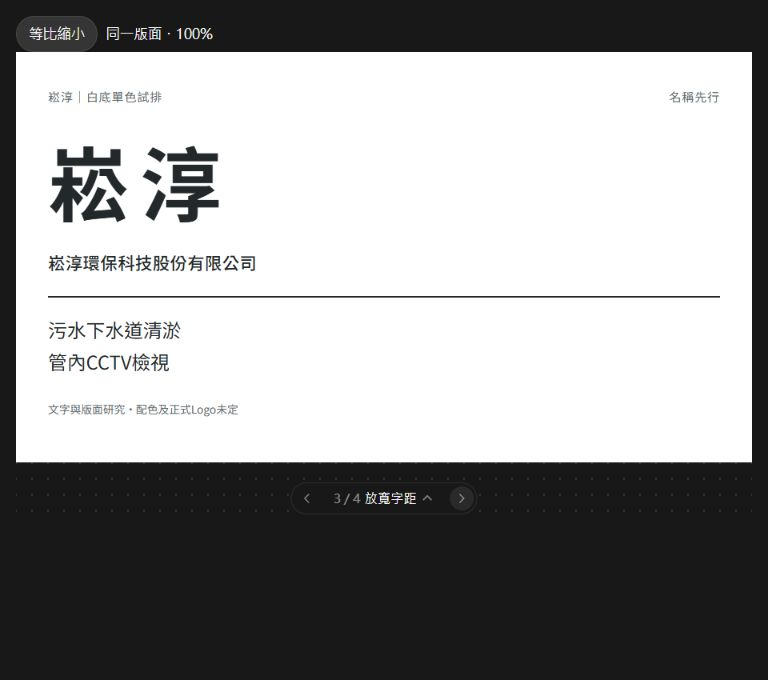
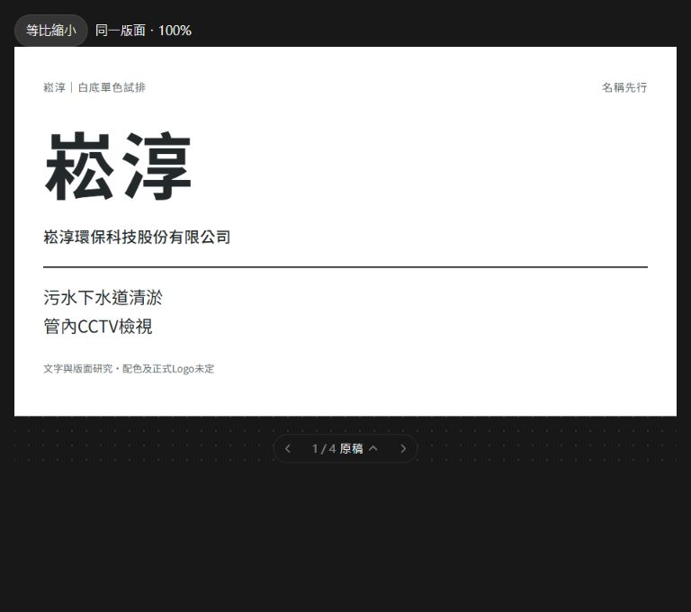
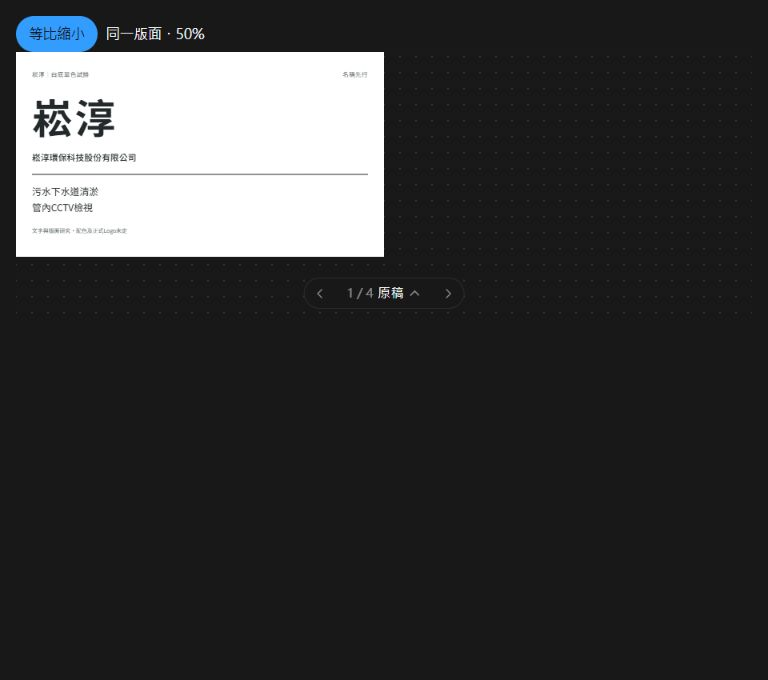
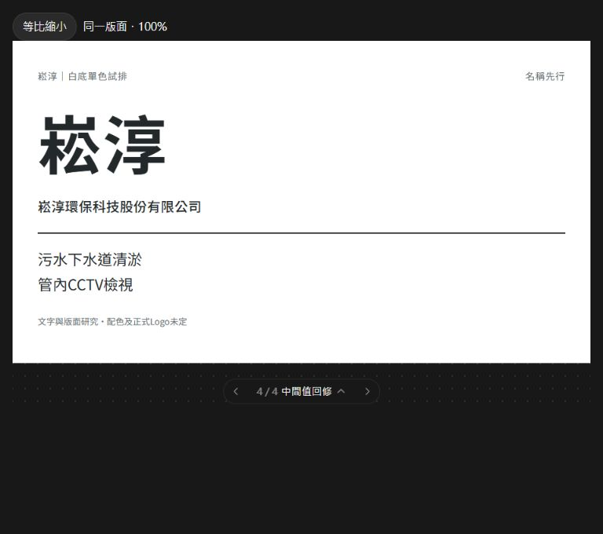
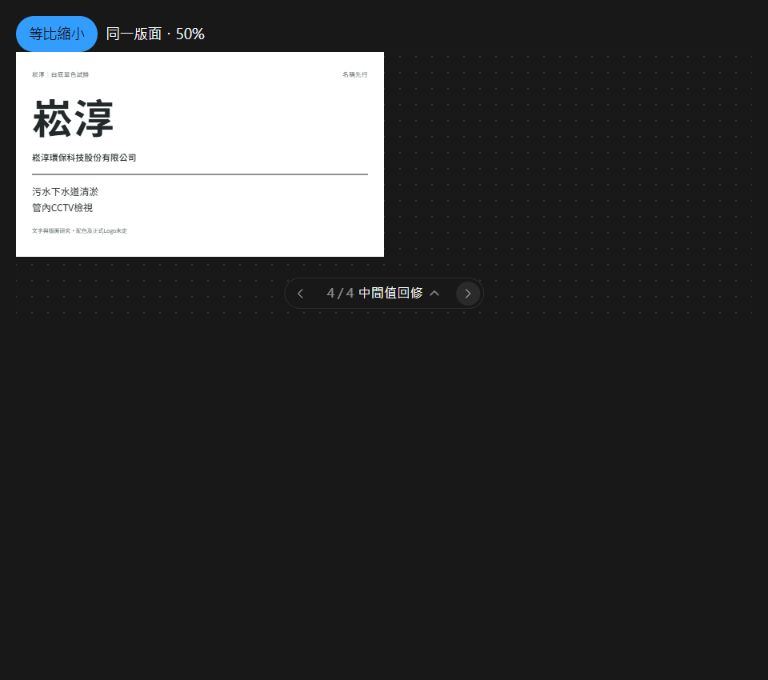
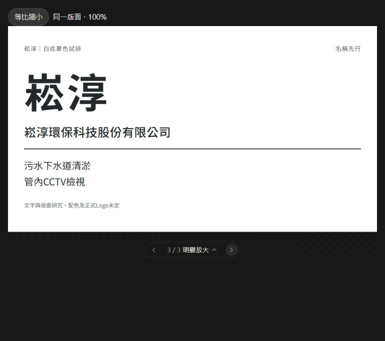
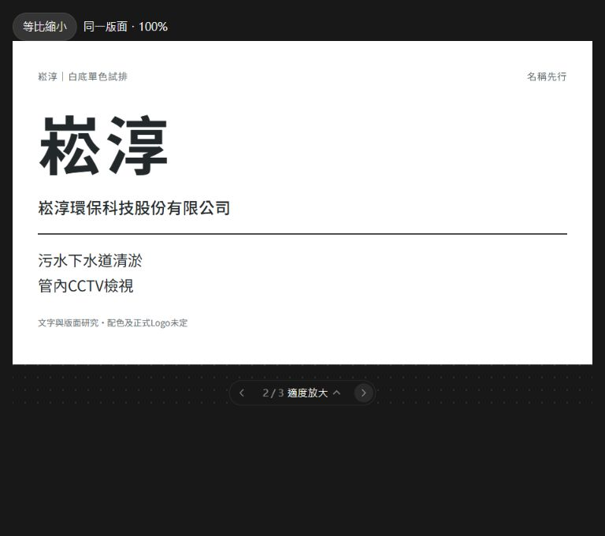
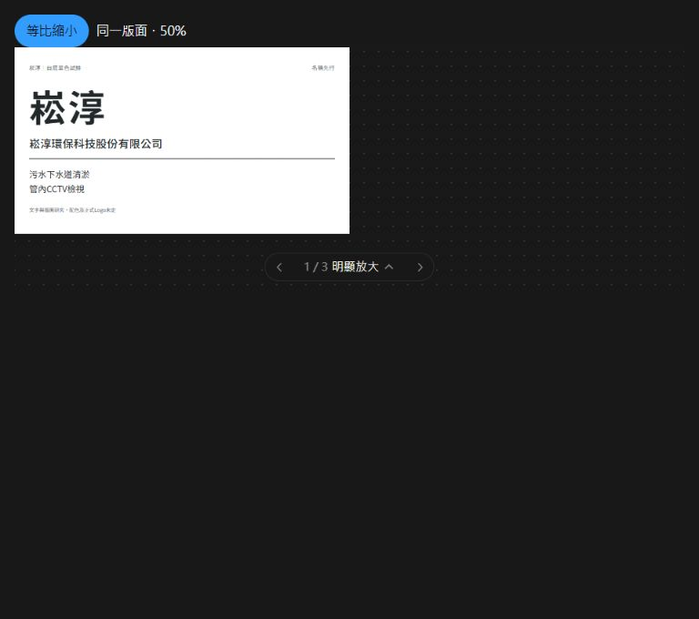

# 原圖同圖回評入口

這16張為GPT既有原截圖，未重繪、未換色；對應字距8張、全名字級6張、最終2張。原HTML片段與雜湊見manifest.json。

截圖只建立雙方能看同一原圖的條件；不證明Claude已看過，也不代表現行配色、Logo或正式CIS標準。字型原始位元組與完整宿主未恢復。

## spacing/loose-full.jpg

## spacing/loose-half.jpg

## spacing/original-full.jpg

## spacing/original-half.jpg

## spacing/refined-full.jpg

## spacing/refined-half.jpg

## spacing/tight-full.jpg

## spacing/tight-half.jpg

## fullname/large-full.jpg

## fullname/large-half.jpg

## fullname/medium-full.jpg

## fullname/medium-half.jpg

## fullname/original-full.jpg

## fullname/original-half.jpg

## final/final-recommended-full.jpg

## final/final-recommended-half.jpg

