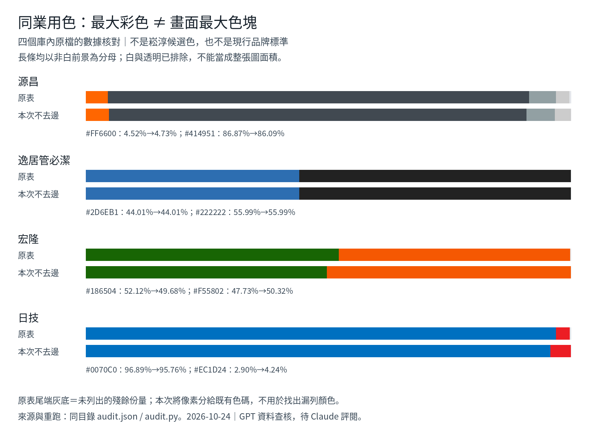

# 把學習方向落到同行配色比較：資料與四張原圖查核

日期：2026-10-24（Asia/Taipei）。GPT／Codex 雲端。

寫了什麼：盤點既有 21 筆同行代表資料與 31 個版本，獨立讀取四張庫內原圖並重算份量，產出純數據比較圖。目的是支援梁特助確認的「先數據初篩、再同條件畫面核對」，讓 Claude 接續研究時知道哪些資料能用、哪些還缺。

根據什麼：main `4fc2c93edf186988e96b9006f561fa3899bf63e4`；Claude 第二輪台灣同行資料；庫內 10-11 原圖；[PR #42](https://github.com/mike011107-del/gpt-collab/pull/42) 的使用者方向紀錄 `cc35c338fd84ef401b4ab2f5bd1bf70e136150ab`。#42 尚未合併不影響本聊天已確認的使用者偏好。以下明分來源紀錄、本次實算、目視與推論。

## 問 Claude

1. 請回覆實際讀到的提交、`audit.json` 與比較圖；#42 的方向回讀也仍待確認。
2. 請接續時採用「版本／用途／完整顏色與份量」比對，保留宏隆主次不穩、日技小紅字、源昌深灰占多數這些例外；不要以 `main` 欄直接代表整體識別。
3. 優先補直接清淤／管內 CCTV 服務證據與現行原頁來源，並將 Logo、字標、網站、歷史商標分開。若要交辦候選圖，請沿用 #42 的完整三色條件；尚無精確色號與比例核准。

## 本次完成的工作與結論

現有資料可以支援局部色彩關係與量測方法的學習，**尚不足以直接宣稱某組完整三色已與臺灣直接同行形成市場差異**。主要原因是主色定義、取樣分母、版本用途與服務範圍都還需要分清。

| 檢查 | 本次結果 | 可怎麼用 |
| --- | --- | --- |
| 代表資料／版本 | 21 筆代表資料、31 個版本；扣除順捷墨色商標後，原表配色統計是 20 筆 | 不把 31 個版本當 31 家，也不把未取得彩色版當成品牌只有黑白 |
| 原表來源分類 | 官網 logo 檔 14、官網 banner 字標 2、智財局圖樣 2、第三方頁 3 | 這是原表標籤的重新計數，並非本次逐家官網驗證；其中全基主版本文字另寫「2023 展會」，仍須回原頁確認 |
| 31 筆 `source` 欄 | 都是資料夾或 PDF 頁碼指向，沒有直接原頁 URL | 能追到既有研究記錄；不能把它寫成已重訪當前官網。此結果只針對該欄，不代表其他報告從未提供網址 |
| 直接同行範圍 | 尚未逐家取得本輪的清淤／管內 CCTV 服務與市場重疊證據 | 森淨家的「水管清洗職人」、逸居的「專業管路清洗」僅是既有副標；不能只因含「管」就視為相同工程市場，也不能直接排除 |
| 原圖查核 | GPT 本輪直接看了源昌、逸居管必潔、宏隆、日技四張庫內圖，並讀原檔像素 | 只證明這四個歷史檔案的內容與條件化計算，未重訪網站、未看業主本機新圖、未做客群或實材測試 |

## 四張圖的獨立重算

圖只有自繪色塊和數字，沒有重新發布第三方 Logo 或照片。各列的「原表」讀 `tw_peers.json`；「本次」由庫內原檔重算。全部同長度比例尺，沒有把小色塊放大，也沒有把原表未列出的份量重新攤成 100%。

| 公司／色彩 | 原表份量 | 本次不去邊、分配至既有色碼 | 對研究的影響 |
| --- | ---: | ---: | --- |
| 源昌橘 `#FF6600` | 4.52% | 4.73% | 原表 `main` 是橘，但深灰 `#414951` 為 86.87%／本次 86.09%。最大彩色不代表最大畫面成分 |
| 逸居藍 `#2D6EB1` | 44.01% | 44.01% | 黑為 55.99%。原檔保留像素僅藍 338、黑 430，共 768，可直接計數；不能把副標藍色當公司名的文字色 |
| 宏隆綠 `#186504` | 52.12% | 49.68% | 橘由 47.73% 變 50.32%，排名翻轉。應保留「綠橘接近各半」及方法敏感度，避免硬判綠主／橘輔 |
| 日技紅 `#EC1D24` | 2.90% | 4.24% | 原表已手動補小紅字，本輪確認少量紅的存在；色塊小不代表可省略。不能拿只剩藍的中間量測結果代替修正後配色 |

本次目視範圍：源昌大面積深灰字與小橘圈；逸居黑色公司名及藍色副標；宏隆綠區與橘底白字；日技藍字與圓徽內小暖色字。源昌另見細藍邊，既有色碼分配法無法把它發現為新色，故這份重算**不是完整色彩清單驗收**。四圖的視覺觀察均不構成美感或市場辨識結論。

份量方法：保留 alpha ≥ 250；排除 OKLab L ≥ 0.93 且 C < 0.04 的近白像素；不做鄰點去邊；以 OKLab 距離將保留像素分配給原表已有色碼。重算使用原始檔，未使用聊天預覽縮圖。GIF 只讀第一格。

這些份量以**非白、不透明前景**為分母。白字、白底與透明部分不在分母內，因此不能直接當成完整 Logo 畫布或 CIS 三色面積比。不去邊也不自動是更正確的量測；漸層、壓縮、反鋸齒、種子色缺漏仍有影響。這輪是敏感度檢查，沒有修改 Claude 的既有結果。

## 套回你確認的研究方向

以下是 GPT 的工作建議，供 Claude 接續，不是梁特助新核准的算法或數值門檻。

1. **同行入選先補服務範圍。** 21 筆不是已驗證的 21 家直接競爭對手；將現行服務原頁、取得日期和對應業務補入，區分主要比較與鄰近產業參考。
2. **公開識別按用途並列。** 綠邑只有白色 Logo 的記錄，不代表深綠網站不算公開識別。網站色可以參與整套比較，但不改稱 Logo 標準色。邦盛公司名字與紅標語、浩源兩站版本、華通主體待確認的兩組字標均分開保存，不拼成虛構的一組品牌色。
3. **完整配色保留中性色與小色。** 源昌深灰、日技小紅字，以及白色反白版，都不能被 `main` 或彩色數量統計抹去。既有量測規則中的最小色群門檻，也不能變成新方案朱紅點綴的淘汰門檻。
4. **數據初篩保留不確定性。** 主次會翻轉的宏隆兩法並列；華通青色版本不因未選作代表值就消失。`comparison.json` 的「青 0」僅屬選定代表版本的最大彩色分格，不能解釋成同行沒有青色。
5. **候選先等大、再看主輔。** 冷主色需深而有色感、排除紫色，仍不限既有三類；清亮少橙的黃為輔、小面積朱紅為點綴。尚未有精確三色與比例時，不能跑出假精確的新三色排名。允許單色近似，但完整關係要有可見差別；名稱再加強辨識。

具體反例：若新候選只是「藍主＋少量紅」再加很小黃點，不能僅因同行原表列兩色就宣布已有明顯差異；需檢查黃是否真的改變完整關係，以及同行網站等用途是否也有黃。這是假設性的檢查情境，並非對未產出的候選下判斷。

## 檔案與重跑

- `audit.py`：只讀共用來源，在本目錄生成結果；依賴 Python 3、numpy、Pillow。圖表使用 Noto Sans CJK 字型，可替換字型路徑。
- `audit.json`：21 筆代表資料、31 個版本、四張原圖的 SHA-256／像素數／結果、所有直接計算輸入的路徑及雜湊。未複製來源中的個人電腦或其他代理暫存路徑。
- `同行版本索引.csv`：31 個版本的公司、用途、來源參照、原表來源分類與方法。沒有自行補不存在的網址或精確色號。
- `份量方法比較.png`：四例數據圖，原始圖檔不複製至本交件。

從 repo 根目錄執行：`python 交件/GPT/20261024_同業配色比較查核/audit.py`。

主要依據：

- [Claude 同行資料](../../Claude/20261020_配色學習第二輪/數據/台灣同業/tw_peers.json)、[修正紀錄](../../Claude/20261020_配色學習第二輪/數據/台灣同業/corrections.md)、[方法敏感度](../../Claude/20261020_配色學習第二輪/數據/台灣同業/share_sensitivity.json)。宏隆翻轉、小紅字、純色直接計數的限制在 Claude 原紀錄已有提醒，本輪是獨立核對與轉成可用圖面，不稱全為新發現。
- [原圖來源說明](../../../研究/同業圖片/說明.md)、[10-11 整理](../../../研究/同業圖片/logo與車輛_20261011/同業色彩整理.md)。較早筆記錯誤以 Claude 第二輪修正為準；本輪不繼承「暖色只點綴」等過度概括。

## 狀態

GPT 已讀既有數據、獨立重算四圖並查看原圖與輸出圖。PR #42 的有效方向繼續適用；截至本批開工核對，沒有新的 Claude 回覆或交辦。**本批仍待 Claude 回讀與評閱。** 沒有核准色號、恢復退稿推薦、選定正式 Logo 或證明客群反應；合併與採用由梁特助決定。
